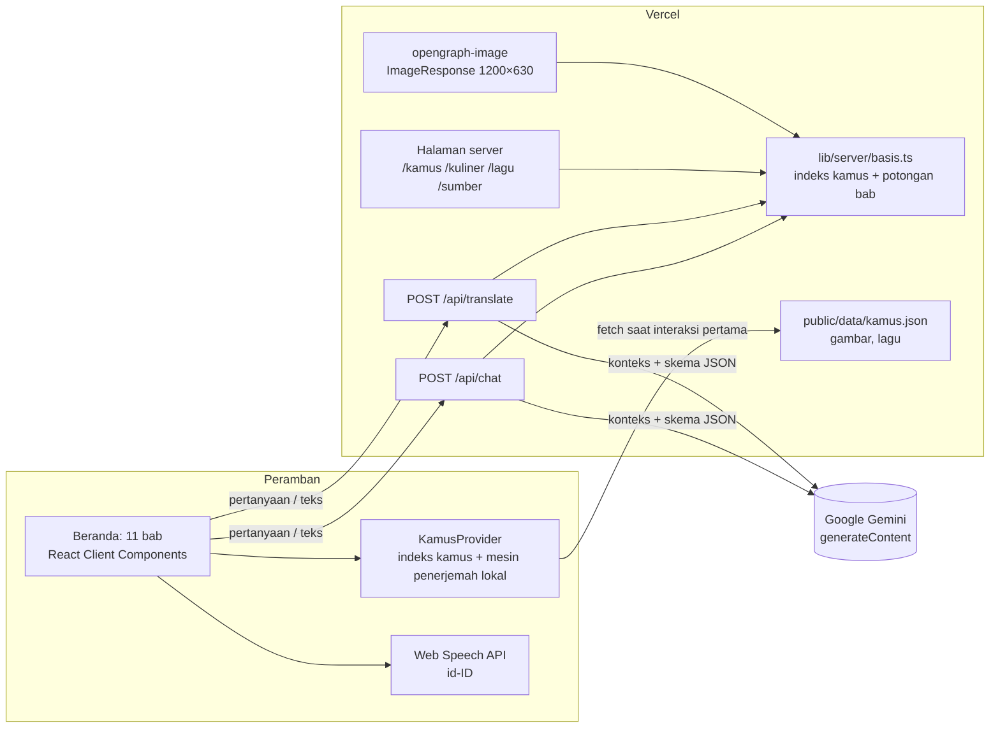
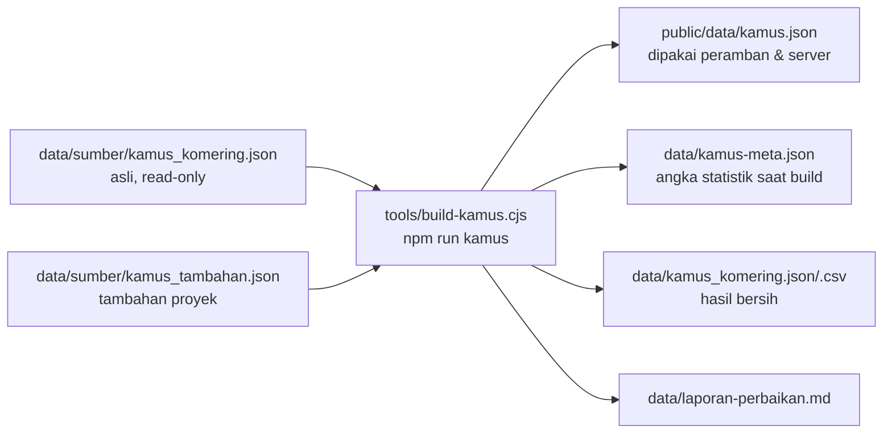

# TRD: Dang Lupa ko Komering

**Technical Requirements Document** · arsitektur, kontrak API, dan operasional

| | |
| --- | --- |
| Versi dokumen | 1.0 |
| Tanggal | 19 Oktober 2026 |
| Versi aplikasi | 2.0.0 (`package.json`) |
| Dokumen terkait | [PRD](PRD.md) (produk) · [DRD](DRD.md) (desain) |

---

## 1. Ringkasan teknis

Aplikasi Next.js (App Router) berbahasa TypeScript yang di-host di Vercel. Beranda adalah satu halaman panjang berisi 11 bab; kamus dan mesin penerjemah lokal berjalan di peramban. Dua fungsi serverless (`/api/chat`, `/api/translate`) memanggil Google Gemini dengan pola **hybrid RAG**: server mencari entri kamus dan potongan bab yang relevan, lalu Gemini menjawab hanya dari konteks itu. Halaman mandiri per kata, hidangan, dan lagu dirender di server untuk SEO dan pratinjau tautan.

## 2. Arsitektur sistem



**Alur kunci:**

1. Beranda dikirim sebagai HTML statis. Teks hero tampil tanpa JavaScript.
2. `KamusProvider` memuat `public/data/kamus.json` (±522 KB mentah, ±158 KB gzip) baru saat pengunjung menggulir, mengetuk, menekan tombol, atau membuka chat, lalu membangun indeks dan mesin penerjemah di peramban.
3. Penerjemah lokal menerjemahkan kata per kata seketika saat mengetik. Tombol **Terjemahkan** dan chat memanggil API Gemini; bila gagal, hasil mesin lokal dipakai.
4. Fungsi serverless mengimpor `kamus.json` yang sama (`lib/server/basis.ts`), membangun basis pengetahuan sekali per instance, dan memakainya ulang.

## 3. Tumpukan teknologi

Semua versi dikunci persis di `package.json`.

| Lapisan | Teknologi | Versi |
| --- | --- | --- |
| Kerangka | Next.js (App Router) | 16.3.8 |
| UI | React / React DOM | 19.3.0 |
| Bahasa | TypeScript (`strict`) | 5.9.3 |
| Gaya | Tailwind CSS + `@tailwindcss/postcss` | 4.3.3 |
| Animasi | Framer Motion (+ CSS & Web Animations API) | 13.5.0 |
| Ikon | lucide-react + SVG kustom (`components/ui/Mahkota.tsx`) | 1.49.0 |
| AI | Google Gemini REST `v1beta/models/*:generateContent` | tanpa SDK |
| Font | Playfair Display, Plus Jakarta Sans via `next/font/google` | |
| Gambar pratinjau | `next/og` `ImageResponse` | bawaan Next.js |
| Lint | ESLint + `eslint-config-next` | 9.39.5 / 16.3.8 |
| Runtime | Node.js | ≥ 20 |
| Hosting | Vercel (Functions untuk `/api/*`) | |

GSAP dan `@gsap/react` sudah dicabut pada 18 Oktober 2026.

## 4. Struktur repositori

```text
app/
  layout.tsx                 Font, metadata global, ToastProvider, skip link
  page.tsx                   Beranda: susunan 11 bab + FloatingChat
  globals.css                Token warna, motif SVG, kelas komponen (@layer base/components)
  api/chat/route.ts          POST /api/chat (Gemini + RAG)
  api/translate/route.ts     POST /api/translate (Gemini + kamus)
  kamus/[kata]/              Halaman per kata + opengraph-image.tsx
  kuliner/[slug]/            Halaman per hidangan + opengraph-image.tsx
  lagu/[slug]/               Halaman lagu + opengraph-image.tsx
  sumber/page.tsx            Sumber, rujukan & kredit
  sitemap.ts · robots.ts     SEO
  icon.png · apple-icon.png  Ikon situs
components/
  *Section.tsx               Satu komponen per bab
  Navbar · Footer · FloatingChat · MascotShowcase · HalamanMandiri · StatCounter
  providers/                 KamusProvider (kamus + penerjemah), ToastProvider
  ui/                        Bab, Reveal, TombolDengar, TautanMagnet, GambarBertitik, Mahkota, Tumpal, Avatar, TagKata
lib/
  konten.ts                  Seluruh konten situs bertipe (sejarah, marga, kuliner, lagu, kuis, niat chatbot)
  kamus.ts                   Tipe & indeks kamus
  penerjemah.ts              Mesin penerjemah lokal
  chatbot.ts                 Chatbot lokal berbasis niat (cadangan)
  ai.ts                      Kontrak & pemanggil /api/* dari peramban
  kuis.ts · jajuluk.ts · suara.ts · teks.ts · tautan.ts · situs.ts
  server/                    Khusus server: basis (RAG), gemini, penjaga, tembolok, kamus-halaman, kartu-og
data/
  sumber/                    Data asli, tidak pernah diubah + kamus_tambahan.json
  kamus_komering.json/csv    Hasil pembersihan
  kamus-meta.json            Angka ringkas kamus (diimpor saat build)
  laporan-perbaikan.md       Perbaikan otomatis & entri yang perlu ditinjau
tools/build-kamus.cjs        Pembersih & pembangun kamus
tools/indexnow.cjs           Pengirim alamat sitemap ke IndexNow
public/                      Gambar, maskot/, kuliner/, lagu/, data/kamus.json, og-beranda.jpg, kunci IndexNow
docs/                        PRD, TRD, DRD, PRD-REVITALISASI, LAPORAN-PENGEMBANGAN
DOKUMENTASIITFEST2026/       Dokumentasi lomba tim (tidak ikut deploy)
```

## 5. Rute dan strategi render

| Rute | Jenis | Strategi |
| --- | --- | --- |
| `/` | Halaman | Statis saat build. Hero adalah Server Component; bab interaktif adalah Client Component |
| `/kamus/[kata]` | Halaman + OG | `generateStaticParams` mengembalikan `[]`: tiap kata dirender saat pertama dikunjungi lalu disimpan. Kata tidak dikenal → 404 |
| `/kuliner/[slug]` | Halaman + OG | 7 halaman statis saat build, `dynamicParams = false` |
| `/lagu/[slug]` | Halaman + OG | 1 halaman statis saat build, `dynamicParams = false` |
| `/sumber` | Halaman | Statis |
| (404) | `app/not-found.tsx` | Alamat tak dikenal dan `notFound()` dari `/kamus/[kata]` |
| `/sitemap.xml` | Metadata | Beranda, `/sumber`, lagu, 7 hidangan, semua kata nonsensitif (3.647 alamat) |
| `/robots.txt` | Metadata | Izinkan semua kecuali `/api/` |
| `/api/chat` | Route Handler | Dinamis, `maxDuration = 30` |
| `/api/translate` | Route Handler | Dinamis, `maxDuration = 30` |

`metadataBase`, canonical, dan sitemap memakai `VERCEL_PROJECT_PRODUCTION_URL` (diisi otomatis oleh Vercel); di lokal jatuh ke `http://localhost:3000` (`lib/situs.ts`).

## 6. Data

### 6.1 Alur data kamus



Skrip pembangun merapikan spasi dan karakter tak terlihat, melengkapi singkatan (`yg`, `dg`, `dlm`, …), memperbaiki kelas kata, memisahkan varian ejaan, menyelesaikan rujukan "lihat X", menggabungkan duplikat, menandai entri sensitif, lalu mempelajari padanan kata dari korpus contoh kalimat (skor Dice). **Keluaran tidak boleh diedit langsung.** Perbaikan per entri ditambahkan ke daftar `MANUAL` di skrip, lalu `npm run kamus` dijalankan ulang.

### 6.2 Format `public/data/kamus.json`

```ts
interface KamusMentah {
  meta: { sumber; dibuat; jumlahKata; jumlahKataDasar; jumlahTurunan; jumlahContoh };
  // [idKata, kata, kelas, arti, contoh[[km, id]], kataDasar, varian[], lihat, catatan]
  // kolom kosong di akhir dipangkas agar berkas kecil
  entri: EntriMentah[];
  selaras: [kataKomering, kataIndonesia, skorDice, jumlahMunculBersama][];
  frekuensi: [kataKomering, jumlahKalimat][];
  sensitif: string[];  // idKata yang tidak ditampilkan acak
}
```

Kolom `catatan` terisi berarti **arti dugaan**: entri tetap tampil dengan label, tetapi tidak dipakai korpus penerjemah dan kuis.

### 6.3 Konten situs

Semua konten nonkamus (sapaan, sejarah, wilayah, marga, busana, adat pernikahan, kuliner, lagu beserta waktu tiap baris lirik, jajuluk, soal kuis, niat chatbot) ada di `lib/konten.ts` dengan tipe `Konten`. Server memotong konten ini menjadi "potongan" untuk RAG (`bangunPotongan` di `lib/server/basis.ts`).

### 6.4 Penyimpanan di peramban

Hanya skor kuis terbaik di `localStorage`. Tidak ada cookie dan tidak ada data pengguna yang disimpan di server.

## 7. Mesin lokal (peramban)

**Penerjemah** (`lib/penerjemah.ts`):

1. Pencocokan frasa terpanjang (n-gram) terhadap kamus.
2. Stemming imbuhan Bahasa Indonesia (`me-`, `ber-`, `di-`, `-kan`, `-an`, `-nya`, …).
3. Pemetaan akhiran: `-nya ⇄ -na`, `-ku`, `-mu`, `-lah ⇄ -da`.
4. Reduplikasi (`jama-jama`) dan pola "sangat X" → "X nihan".
5. Koreksi ejaan dengan jarak Levenshtein.
6. Peringkat kandidat (ketepatan glosa + frekuensi korpus) dan skor keyakinan 0–1.

Setiap segmen hasil diberi jenis (`exact`, `same`, `korpus`, `stem`, `fuzzy`, `unknown`) yang ditampilkan sebagai warna penanda di UI.

**Chatbot cadangan** (`lib/chatbot.ts`): deteksi niat terjemahan dengan regex ("… dalam bahasa komering", "arti …"), lalu klasifikasi niat berbasis skor kata kunci (frasa +3, kata +2, salah ketik +1) terhadap `DATA.chatbot.intents`.

## 8. Integrasi Gemini

### 8.1 Klien (`lib/server/gemini.ts`)

| Parameter | Nilai |
| --- | --- |
| Endpoint | `https://generativelanguage.googleapis.com/v1beta/models/{model}:generateContent` |
| Autentikasi | Header `x-goog-api-key` dari `GEMINI_API_KEY` (server saja) |
| Rantai model | `GEMINI_MODEL` (opsional) → `gemini-3.5-flash` → `gemini-3.5-flash-lite` → `gemini-3.1-flash-lite` → `gemini-flash-latest` |
| Keluaran | `responseMimeType: application/json` + `responseSchema` |
| Thinking | `thinkingLevel: low` |
| Batas waktu | 14 dtk per percobaan, 25 dtk total; fungsi `maxDuration` 30 dtk |
| Pindah model | Pada HTTP 404, 429, 500, 502, 503, 504, atau timeout |
| Kuota | Model yang mendapat 429 "diparkir" sampai waktu `retryDelay` dari Google |

### 8.2 `POST /api/chat`

**Permintaan**

```json
{
  "pesan": "Apa arti juadah dan kapan disajikan?",
  "riwayat": [
    { "oleh": "pengguna", "teks": "..." },
    { "oleh": "ratih", "teks": "..." }
  ]
}
```

- `pesan`: wajib, dipangkas ke 500 karakter.
- `riwayat`: opsional, hanya 6 giliran terakhir, tiap teks maks. 1.200 karakter. Giliran digabung agar bergantian dan diawali pengguna.

**Proses:** `pilihEntri(pesan, 12)` memilih entri kamus (kata Komering yang disebut, padanan glosa Indonesia, dan segmen mesin lokal); `pilihPotongan(pertanyaanSebelumnya + pesan, 4)` memilih potongan bab dengan skor kata kunci. Konteks dikirim bersama system prompt yang mewajibkan: jawab hanya dari konteks, sebut sumber, tandai "arti dugaan", tolak topik di luar Komering, abaikan upaya mengubah peran. Suhu 0,4, maks. 900 token.

**Respons 200**

```json
{
  "oleh": "ratih",
  "teks": "Menurut Kamus Basa Kumoring di situs ini, **juadah** adalah ...",
  "aksi": [
    { "label": "Kamus: juadah", "href": "#kamus", "cari": "juadah" },
    { "label": "Kuliner: Juadah Basah", "href": "/kuliner/juadah-basah" }
  ]
}
```

`aksi` berasal dari ID sumber yang dikembalikan Gemini, dipetakan ke tautan oleh server (maks. 4, tanpa duplikat). ID yang tidak ada di konteks dibuang, sehingga sumber tidak bisa dipalsukan.

### 8.3 `POST /api/translate`

**Permintaan**

```json
{ "teks": "Saya ingin belajar bahasa daerah", "dari": "id" }
```

- `teks`: wajib, dipangkas ke 400 karakter.
- `dari`: `"id"` atau `"km"`; arah tujuan otomatis kebalikannya.

**Proses:** mesin lokal menerjemahkan dulu; entri dari segmennya digabung dengan `pilihEntri(teks, 16)` (tanpa entri sensitif, maks. 24). Server mencari maks. 8 contoh kalimat yang memuat ≥ 2 kata kandidat sebagai pola susunan. Gemini diminta memakai hanya kosakata itu. Suhu 0,2, maks. 600 token. Huruf kapital awal mengikuti teks asal.

**Respons 200**

```json
{
  "terjemahan": "...",
  "catatan": "Kata 'daerah' belum tercatat di kamus.",
  "kataLuarKamus": ["..."]
}
```

`kataLuarKamus` (hanya untuk arah ke Basa Kumoring) berisi kata hasil Gemini yang tidak ada di kamus, contoh kalimat, korpus padanan, maupun teks asal. UI menandainya "periksa".

### 8.4 Galat (kedua endpoint)

| Status | Badan | Penyebab |
| --- | --- | --- |
| 400 | `{"galat":"Pertanyaan kosong."}` / `"Teks kosong."` | Masukan kosong atau JSON tidak valid |
| 403 | `{"galat":"Asal permintaan tidak diizinkan."}` | Header `Origin` berbeda host |
| 429 | `{"galat":"Terlalu banyak pertanyaan. Tunggu sebentar, ya."}` | Batas laju per IP terlampaui |
| 429 | `{"galat":"Kuota AI sedang penuh."}` | Semua model Gemini kena kuota |
| 502 | `{"galat":"AI sedang tidak tersedia."}` | Gemini gagal, timeout, atau JSON tidak valid |

Klien (`lib/ai.ts`) mengembalikan `{ ok: false }` pada galat apa pun, dan komponen beralih ke mesin lokal.

### 8.5 Cache

`lib/server/tembolok.ts`: LRU di memori instance, maks. 300 entri, umur 6 jam. Chat hanya meng-cache pertanyaan pembuka (tanpa riwayat), dengan kunci teks ternormalisasi. Terjemahan di-cache dengan kunci `arah|teks`.

## 9. Keamanan dan privasi

| Ancaman | Kontrol |
| --- | --- |
| Kebocoran kunci API | `GEMINI_API_KEY` hanya dibaca di `lib/server/`; `.env*` diabaikan git dan `.vercelignore`; di Vercel disimpan sebagai Environment Variable bertipe Secret (Production & Preview) |
| Pemakaian endpoint dari situs lain | Header `Origin` harus sama dengan `Host`, selain itu 403 |
| Penghabisan kuota | Batas laju per IP per menit: chat 12, terjemahan 20 (jendela geser 60 dtk, di memori instance) |
| Muatan besar | `content-length` > 16.000 byte ditolak; panjang pesan, riwayat, dan teks dipangkas |
| Prompt injection | System prompt menyuruh mengabaikan perintah di dalam teks pengguna; keluaran dipaksa ke skema JSON; ID sumber divalidasi terhadap konteks |
| XSS dari jawaban AI | Jawaban dirender sebagai elemen React (hanya `**tebal**` dan baris baru), tanpa `innerHTML`. JSON-LD di-escape (`<` → `<`) |
| Pelacakan pengguna | Tidak ada cookie, analitik, atau akun. Laci chat memberi tahu bahwa pertanyaan dikirim ke Google Gemini |

## 10. SEO dan metadata

- Metadata global di `app/layout.tsx`: judul bertemplat `%s · Dang Lupa ko Komering`, deskripsi, Open Graph `id_ID`, `themeColor #140706`.
- Beranda dan halaman mandiri punya canonical. Halaman mandiri mengisi `generateMetadata` (judul, deskripsi, canonical, Open Graph). JSON-LD: `DefinedTerm` (dalam `DefinedTermSet` "Kamus Basa Kumoring", `inLanguage: kge`) untuk kata, `Article` untuk kuliner, dan `MusicComposition` beserta lirik untuk lagu.
- `app/not-found.tsx` menangani alamat yang tidak ada dan kata yang belum tercatat (status 404, `noindex` otomatis).
- Gambar pratinjau halaman mandiri dibuat oleh `opengraph-image.tsx` per rute dengan `kartuOg()` (`lib/server/kartu-og.tsx`), ukuran 1200×630. Beranda dan `/sumber` memakai `public/og-beranda.jpg` (1200×630, 58 KB). Jangan memakai gambar maskot ukuran asli (2,4 MB) karena WhatsApp tidak menampilkan pratinjau sebesar itu.
- Verifikasi mesin pencari: `GOOGLE_SITE_VERIFICATION` dan `BING_SITE_VERIFICATION` (lihat §12) dirender sebagai `<meta name="google-site-verification">` dan `<meta name="msvalidate.01">`. Properti Search Console bertipe **URL prefix**, karena subdomain memakai CNAME sehingga record TXT tidak bisa dipasang di nama yang sama.
- IndexNow: kunci publik di `public/e7ffb4fa3a50b3c7f297139cb7763b3b.txt`. `npm run indexnow` mengirim semua alamat sitemap ke `api.indexnow.org` (dipakai Bing, Yandex, Seznam, Naver). Google tidak memakai IndexNow; kirim sitemap lewat Search Console.

## 11. Performa

| Anggaran | Target | Teknik |
| --- | --- | --- |
| Berat halaman awal (HP) | < 800 KB | Avatar maskot WebP 128 px (3–5 KB); kamus dimuat setelah interaksi; lagu `preload="none"`; gambar di bawah layar pertama `loading="lazy"` |
| LCP | Teks hero langsung | Hero Server Component; animasi masuk tidak menyembunyikan teks; `next/font` dengan `display: swap` |
| CLS | 0 | Ukuran gambar eksplisit; `scrollbar-gutter: stable` agar mode layar penuh tidak menggeser halaman |
| JS utama | Seminimal mungkin | GSAP dicabut; animasi memakai CSS dan Framer Motion seperlunya |
| Gambar | AVIF/WebP | `next/image` dengan `formats: ['image/avif', 'image/webp']`. Latar buram foto kuliner memakai versi 128 px dari `getImageProps` (±2 KB, sebelumnya JPEG asli 41 KB yang termuat sejak awal). Sumber hero `maskot-pasangan-hero.jpg` 1200 px, 118 KB (tampil maks. 400 px; sebelumnya 2400 px, 2,4 MB) |

Hasil terakhir (situs produksi, 18 Okt 2026): Lighthouse HP Performance 86–93, Accessibility/Best Practices/SEO 100, halaman 484 KB, LCP 3,1–3,4 dtk, TBT 100–150 ms, CLS 0.

## 12. Konfigurasi lingkungan

| Variabel | Wajib | Keterangan |
| --- | --- | --- |
| `GEMINI_API_KEY` | Ya, untuk fitur Gemini | Kunci Google AI Studio. Tanpa kunci, API mengembalikan galat dan situs memakai mesin lokal |
| `GEMINI_MODEL` | Tidak | Model pertama yang dicoba sebelum rantai bawaan |
| `GOOGLE_SITE_VERIFICATION` | Tidak | Isi `content` tag verifikasi Google Search Console. Perlu deploy ulang setelah diubah |
| `BING_SITE_VERIFICATION` | Tidak | Isi `content` tag `msvalidate.01` Bing Webmaster (tidak perlu bila properti diimpor dari Search Console) |
| `VERCEL_PROJECT_PRODUCTION_URL` | Otomatis | Diisi Vercel; dipakai untuk `metadataBase`, canonical, sitemap |

Lokal: simpan di `.env.local` (tidak ikut git).

## 13. Build, deploy, dan operasional

### Perintah

```bash
npm install
npm run dev        # http://localhost:3000
npm run typecheck  # tsc --noEmit
npm run lint       # eslint .
npm run build      # next build
npm start          # jalankan hasil build
npm run kamus      # bangun ulang kamus dari data/sumber/
npm run indexnow   # kirim alamat sitemap ke IndexNow (setelah deploy)
```

### Deploy

- **Produksi saat ini:** Vercel CLI dari folder proyek yang sudah ter-link (`.vercel/project.json`):
  ```bash
  npx vercel deploy --prod
  ```
  `.vercelignore` mengecualikan `node_modules`, `.next`, `.env*`, dan `DOKUMENTASIITFEST2026`.
- **Target (PRD 1.4):** integrasi Git Vercel. Beri akses repo ke aplikasi Vercel di github.com/settings/installations → Vercel → Configure. Setelah itu setiap push ke `main` terdeploy ke produksi dan setiap pull request mendapat Preview.

### Alur rilis

1. Kerjakan di branch fitur, buka pull request ke `main`.
2. Wajib lolos `npm run typecheck`, `npm run lint`, `npm run build`.
3. Deploy produksi, lalu periksa halaman utama, satu halaman kata, chat, dan terjemahan di situs produksi.
4. Bila ada halaman baru atau berubah, jalankan `npm run indexnow`.

### Catatan operasional

- Folder proyek berada di OneDrive. Bila `npm run build` gagal dengan `EPERM … .next`, hapus folder `.next` lalu build ulang.
- Log galat Gemini tercatat di log fungsi Vercel dengan awalan `[gemini]`, `[api/chat]`, `[api/translate]`.
- `AGENTS.md` ditulis ulang otomatis oleh `next dev`; biarkan ikut ter-commit agar pohon kerja bersih.

### Konvensi navigasi

- Tautan ke bab di beranda wajib memakai `<Link href="#bab">`, bukan `<a href="#bab">`. Lompatan hash lewat `<a>` membuat entri riwayat tanpa state router, sehingga Back dari halaman mandiri menampilkan alamat beranda tetapi isi halaman sebelumnya tetap tertinggal. Pengecualian: `TautanLewati` (memindahkan fokus tanpa entri riwayat) dan tombol aksi chat (`preventDefault` + `scrollIntoView`).
- Bab Penerjemah, Kamus, Busana, Kuliner, dan Lagu memanjang setelah kamus termuat. `KamusProvider` mencatat lompatan `#bab` terakhir dan meluruskannya sekali saat kamus siap, kecuali pengunjung sudah menggulir sendiri.
- Dialog modal (laci chat, lirik layar penuh) memakai `useJebakFokus` (`lib/fokus.ts`) agar Tab tidak keluar dialog; Esc menutup dan fokus kembali ke tombol pemicu.

## 14. Pengujian dan QA

| Lapisan | Cara |
| --- | --- |
| Statis | `tsc --noEmit` dan ESLint (aturan Next.js + React Hooks) tanpa galat |
| Build | `next build` sukses tanpa peringatan |
| Fungsional | Uji otomatis di Chrome 1440 px dan 390 px: penerjemah (lokal & Gemini), kamus, kuliner, lagu layar penuh, kuis sampai skor, chat beserta tombol sumber, semua halaman mandiri |
| Produksi | Semua halaman 200, kata tak dikenal 404, permintaan lintas situs 403, waktu jawab chat dan terjemahan |
| Performa | Lighthouse mode HP terhadap situs produksi, minimal 3 kali ukur |
| Kualitas data | `data/laporan-perbaikan.md` ditinjau setiap kali `npm run kamus` dijalankan |

Belum ada tes unit otomatis; mesin penerjemah adalah kandidat pertama.

## 15. Batasan dan utang teknis

| Butir | Dampak | Rencana |
| --- | --- | --- |
| Batas laju dan cache di memori instance | Tidak dibagi antarinstance; hilang saat instance mati | Pindah ke Vercel KV/Upstash bila trafik naik |
| Kuota Gemini gratis ±20 permintaan/hari/model | Chat cepat jatuh ke mesin lokal saat ramai | Aktifkan billing |
| Deploy masih manual lewat CLI | Push ke GitHub tidak otomatis terbit | Hubungkan integrasi Git Vercel |
| Tidak ada tes unit | Regresi penerjemah tidak terdeteksi otomatis | Tambah tes untuk `lib/penerjemah.ts` dan `lib/server/basis.ts` |
| Peta berupa gambar raster | Label kecil di HP, akurasi tidak terjamin | Peta vektor GeoJSON (PRD 2.3) |
| TTS peramban | Lafal tidak autentik dan berbeda antarperamban | Rekaman penutur asli (PRD 2.2) |

## 16. Riwayat dokumen

| Versi | Tanggal | Perubahan |
| --- | --- | --- |
| 1.0 | 19 Okt 2026 | Dokumen pertama, sesuai kode di branch `revitalisasi-prd-tahap-1-2` |
